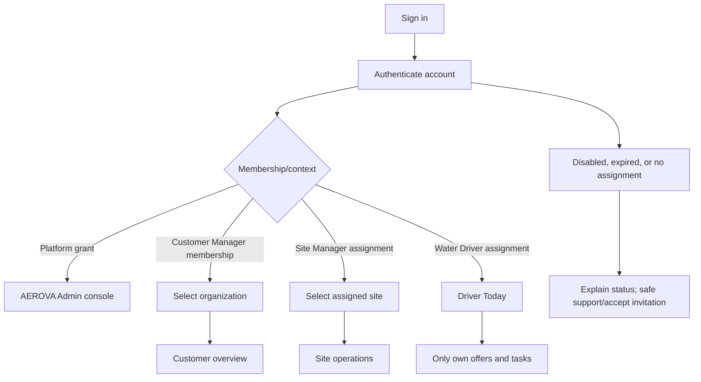
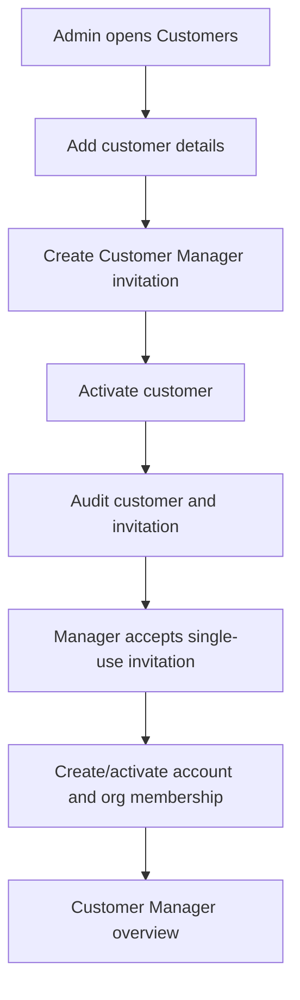
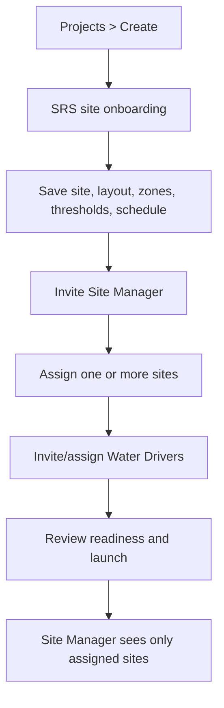
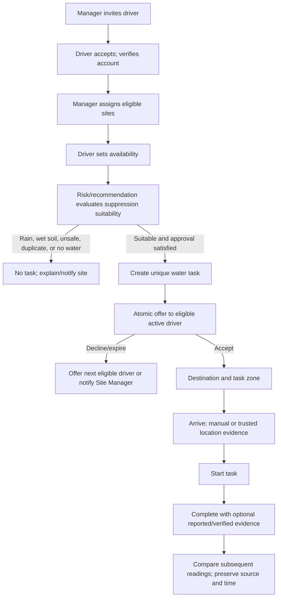

# AEROVA Role-Based Product Design

**Status:** Architecture baseline; role-specific implementation is present in the application, with remaining gaps tracked in `implementation_status.md`.
**Baseline:** AEROVA Final SRS v1.1 plus the user's role-based UX brief.  
**Purpose:** Reviewable design deliverable to approve before implementation.

## 1. Product decisions and existing-state analysis

The SRS remains the baseline for site onboarding, monitoring, provenance, alerts, interventions, water/resource coordination, workforce, reports, devices, site management, and settings. The new brief reorganizes those capabilities around four primary roles; it does not remove the site workflow.

Use exactly these primary role labels in the product: **AEROVA Admin**, **Customer Manager**, **Site Manager**, and **Water Driver**. Existing implementation strings such as `ORGANIZATION_ADMIN`, `PROJECT_MANAGER`, `SITE_OPERATOR`, `EHS_OFFICER`, `MAINTENANCE`, and `VIEWER` are legacy roles and must not remain user-facing primary roles. During migration, map the organization's current `ORGANIZATION_ADMIN` to `CUSTOMER_MANAGER`; map project/site operators to `SITE_MANAGER` only after explicit site assignment; do not silently map viewers to a privileged role. AEROVA Admin is a separate platform-level grant, never an organization membership role.

Current repository state: React/Vite and FastAPI provide separate AEROVA Admin, Customer Manager, Site Manager, and Water Driver entry experiences. Organization/site memberships, role-scoped routes, platform administration, invitation and assignment workflows, driver availability, water-task transitions, task offers, telemetry, alerts, interventions, reports, notifications, and audit records are represented in the application. The backend reads and writes the existing PostgreSQL `aerova` database in schema `aerova_website`; role selection comes from stored user roles rather than fixed login identities. Some resource screens still have data-empty states. Boundary editing, live device overlays, and routing are not complete. Wokwi remains a remote reference with no configured authenticated telemetry transport. These limits are implementation gaps, not claims of shipped capability.

### Sensible defaults / ambiguities resolved

- Keep self-serve customer registration from the SRS: the first registrant becomes that organization’s Customer Manager. Also add the internal AEROVA Admin customer-creation/invitation path.
- One person may have multiple memberships and roles in different organizations/sites. Authorization uses the selected membership context; do not infer scope from a single user-level role.
- Site Managers are assigned per site. Customer Managers have organization-wide access. Water Drivers have task access plus only the minimum site/location/map data needed for assigned tasks.
- Customer status is `ACTIVE`, `INACTIVE`, or `SUSPENDED`; user status is `INVITED`, `ACTIVE`, or `DISABLED`; site/project lifecycle remains `DRAFT`, `ACTIVE`, `COMPLETED`, `ARCHIVED` (exact status transitions to be validated against existing data).
- Driver availability (`ACTIVE` / `INACTIVE`) is independent of task status. Turning inactive prevents new offers but does not hide, cancel, or reassign an accepted task.
- A dust alert can create a reviewable recommendation, never an automatic water task or spray command by itself. A task requires a separate suppression suitability check and configured approval policy.
- “Distance,” route, tanker location, and arrival are shown only when location permission and a real routing/location provider are available. Otherwise show destination address and a manual arrival confirmation, clearly marked as driver-reported.
- Use one exclusive driver per task by default. Multi-driver work must be represented as multiple independently claimable task assignments, not one task accepted by multiple drivers.
- Customer account billing/subscription controls, PDF generation, SMS/push delivery, background workers, realtime WebSocket/SSE, GPS navigation, and verified flow evidence are not assumed to exist. Keep UI states explicit until providers are configured.

## 2. Role definitions and navigation

### AEROVA Admin

**Scope:** All tenant organizations and platform-wide configuration. **Goal:** Operate the SaaS platform, not a construction site. **Restrictions:** No routine interventions, equipment commands, or site operations. Customer dashboard access is read-only, time-bounded, reason-recorded, and visibly marked “Administrative read-only”.

Sidebar: **Overview**, **Customers**, **Projects**, **Users**, **Platform Health**, **Settings**.

- Overview: registered/active/suspended customers; active projects; Site Managers; Water Drivers; connected/offline devices; sites with critical alerts; customer/project growth; recent audited platform activity. No PM charts, site maps, or operating controls.
- Customers: searchable/filterable customer table (name, company/contact, registration, active project/manager/driver counts, status); view; create; activate/deactivate/suspend; invite/reset manager access where supported. Confirmation and audit reason for status changes.
- Projects: cross-customer list (project, customer, location, lifecycle, assigned Site Manager); search/filter; open read-only project view.
- Users: cross-customer user list with customer, role, status, last sign-in; disable/reactivate and resend/revoke invitation subject to policy. Password reset is a secure reset link, never an admin-visible password.
- Platform Health: API/database health, device connectivity, ingestion success/failure, queue/job status if a worker exists, errors and timestamps. Do not invent uptime or job counts when no monitor exists.
- Settings: AEROVA profile, platform configuration, admin security; subscription plan controls only if billing exists.

### Customer Manager

**Scope:** One selected customer organization and all its projects/users/resources. **Goal:** Manage the organization and enter project dashboards. **Restrictions:** No cross-customer or platform administration.

Sidebar: **Overview**, **Projects**, **Site Managers**, **Water Drivers**, **Reports**, **Alerts**, **Resources**, **Settings**.

- Overview: total/active projects, critical-risk projects, Site Manager and Water Driver counts, available drivers, water totals with source coverage, active interventions, recent alerts, project summaries. Aggregates must state time range and missing-data coverage.
- Projects: list/create/edit/archive; SRS site setup; assign managers/drivers; search by name/location/status; open project.
- Site Managers: invite, edit limited profile, assign one or more sites, view assignments/status/last activity, disable/reactivate.
- Water Drivers: invite/create account, name/mobile, assign sites, availability, current task/history, delivery/spray completion and evidence, authorized reassignment/deactivation.
- Reports: cross-project daily/weekly/monthly, dust/risk, intervention, water, driver and device reports; CSV initially; PDF only when implemented. Include project/time/source filters and data gaps.
- Alerts: critical/all project alerts, device/low-water/task events, assignment, notes and resolution. Alert severity is distinct from task authorization.
- Resources: organization-wide water summary, tankers/tasks, driver availability, supplier/vendor approval, replenishment request status.
- Settings: company profile, organization users/roles, preferences, notification/security options, billing only if implemented.

### Site Manager

**Scope:** Only explicitly assigned sites. **Goal:** Run daily site operations and site configuration without customer-wide administration.

Sidebar: **Overview**, **Live Site Map**, **Air Quality**, **Risk & Prediction**, **Interventions**, **Water & Resources**, **Workers & Equipment**, **Water Drivers**, **Alerts**, **Reports**, **Site Management**, **Profile**.

- Overview: SRS site KPIs (PM2.5, PM10, risk, alerts, devices, water level/usage, interventions, activity) with source, quality and freshness.
- Live Site Map: Mapbox boundary/zones/sensors/measured hotspots/wind/predicted plume and tanker/equipment only when their geometry, data, and integrations are real. Visually distinguish measured, predicted, simulation, and no-data layers. Zone click opens readings/risk/actions.
- Air Quality tabs: Live Readings, Historical Trends, Sensor Comparison, Threshold Configuration. Threshold editing is Customer Manager-only by default; Site Manager gets read access and a request-change workflow.
- Risk & Prediction: zone risk, forecast horizon/model/version, factors, data age/quality, recommendations. Label predictions and unknown/stale data.
- Interventions tabs: Recommended Actions, Options, Active, History. Site Manager can review/request/assign and approve only if organization policy grants approval; no direct actuator execution without explicit authorization, verified transport, acknowledgement, and local safety interlocks.
- Water & Resources tabs: Live Water Status, Tank Monitoring, Consumption, Intervention Efficiency, Water History, current tanker tasks; source labels include sensor-verified vs driver-reported.
- Workers & Equipment: presence events, vehicles, machinery, equipment state, source and privacy limits; do not infer identity or exposure where sensor doesn't provide it.
- Water Drivers: only drivers assigned/assignable to this site; view status/task history; invite/assign only if Customer Manager enables that permission; reassign pending work if authorized.
- Alerts: active/acknowledged/resolved, detail, acknowledge, assign, note, resolve.
- Reports: daily/weekly/monthly, air/risk/intervention/water/device health; CSV initially, PDF when implemented.
- Site Management tabs: Site Details, Layout, Zones, Activities, Sensor Assignment, Device Management, Team, Schedule. No org membership, billing, or platform settings. Device credential issue/rotation restricted to Customer Manager or designated device administrator.
- Profile: personal details, password/security, notification preferences, logout.

### Water Driver

**Scope:** Own profile, availability, and assigned/offered tasks. Read only minimal assigned-site destination/zone data. Never render the enterprise dashboard or technical metrics.

Mobile navigation: **Today** and **My Tasks**, plus profile/help/logout. Screens are availability, incoming offer, accepted/navigation, arrival/spray instructions, in-progress, completion confirmation, problem report, task history. Large text and controls; one primary action; offline/pending sync state. Do not show charts, PM values, risk calculations, devices, settings, organization analytics, or general reports.

- Availability: driver name; prominent Active/Inactive toggle; today’s task count; current accepted/in-progress task. Inactive blocks new offers, not current work.
- Offer: “WATER REQUIRED”, site, simple destination, zone/task instruction, expiry, accept/decline. Distance only with reliable location permission/provider. Offer claim is single-winner/atomic.
- Navigation: destination and arrival instructions; open native map only if a routing target exists; otherwise provide address and disclose no live navigation.
- Instructions/in-progress: highlighted zone when real map geometry is available; task quantity/duration only if provided; start, complete, report problem; optional sequence for multiple zones.
- Completion: require confirmation and any configured evidence; record driver-reported volume separately from sensor-verified flow. Show completion time and next task.
- History: New/Offered, Accepted, In Progress, Completed, Declined, Expired, Cancelled, Reassigned, Blocked/Problem; only task-relevant timestamps/details.

## 3. Permission matrix

Legend: **All** = scoped to role’s declared scope; **Assigned** = assigned site/task only; **Policy** = explicit organization/platform grant; **—** = denied. Every API action repeats the check server-side.

| Module/action | AEROVA Admin | Customer Manager | Site Manager | Water Driver |
|---|---|---|---|---|
| View platform/customer overview | All | — | — | — |
| Create customer / change customer status | All; audit reason | — | — | — |
| View projects | All, read-only drill-in | All in organization | Assigned sites | Task destination only |
| Create/edit/archive project | — (support action only via audited policy) | All in organization | Assigned-site fields only | — |
| View site monitoring/risk/map | Read-only admin view, explicit reason | All org sites | Assigned sites | Task zone/destination subset |
| Configure thresholds | Platform defaults only | All org sites | —; request change | — |
| View/manage alerts | Platform health/metadata | All org projects; assign/resolve | Assigned sites; acknowledge/note/resolve by policy | Task-linked human instruction only |
| Create/review intervention | — for routine operation | All org sites; approve by policy | Assigned sites; request/assign/approve by policy | — |
| Execute equipment command | — | Policy + verified authorization | Policy + verified authorization | — |
| Create/assign/reassign water task | Platform exception with audit | All org sites | Assigned sites by policy | — (claim own offer only) |
| Accept/decline/start/complete task | — | Reassign/cancel by policy | View/reassign by policy | Assigned/offered task only |
| Edit driver availability/profile | Account support by audited policy | Org drivers | Assigned drivers only if granted | Own profile/availability |
| Manage organization users | Platform support, audited | All org memberships | Assigned site assignments only, if granted | — |
| Manage site team | — | All org sites | Assigned site, policy-limited | — |
| Provision/revoke devices | Platform support, audited | All org devices | View/assign only if granted | — |
| View/download reports | Platform aggregate | All org projects | Assigned sites | — |
| Manage organization settings/billing | Platform plan controls only | Own organization | — | — |
| Manage platform settings | All | — | — | — |

Delete should be archive/disable for users, customers, projects, tasks and records where audit retention applies. Hard deletion is a separate governed data-retention workflow. Exports are subject to the same scope filters as reads. No WebSocket/SSE subscription may be authorized solely by a user ID; each subscription binds organization and assigned site/task scope and rechecks revocation.

## 4. Screen/action inventory

The navigation sections above define the full screen inventory. This table records primary actions and expected results to avoid decorative, nonfunctional controls.

| Screen | Primary actions | Expected result |
|---|---|---|
| Admin Overview | Open customer/project/activity | Scoped list/detail; read-only site view banner; audit access reason |
| Customers | Search/filter, Add, View, Activate/Deactivate/Suspend | Validated form, confirmation, status update, audit row, user notification where configured |
| Projects | Filter, open read-only project | Project details and assigned manager; no operating controls |
| Users | Search/filter, Disable/Reactivate, Resend/Reset | Account state or secure invitation/reset workflow; audit event |
| Platform Health | Refresh/filter by component | Timestamped service/ingestion data or explicit “not configured” |
| Customer Overview | Choose range/project; open project; reports | Organization-filtered aggregation and project transition |
| Projects | Create/edit, onboarding, assign, archive | Persisted site and membership changes; prevent cross-org assignment |
| Site Managers/Drivers | Invite, edit, assign, deactivate | Single-use expiring invitation; assignment and audit history |
| Customer Reports | Choose projects/time/type/source; export | Scoped CSV with provenance, gaps and export record |
| Customer Alerts/Resources | Assign/resolve/approve request | Persisted state transition, eligibility/approval check, audit |
| Site Overview | Select range; open map/alert/action | Fresh site-specific metrics; clear stale/missing state |
| Live Site Map | Toggle layers; select zone | Render only backed geometry/data; selected zone detail; no invented position |
| Air Quality | Select time/device; request threshold change | Trend/quality context; policy-checked change request |
| Risk & Prediction | Select forecast horizon/zone | Model/version, reasons, data coverage, forecast disclaimer |
| Interventions | Review, request, assign, approve | Draft/approval state; never conflate queued command with completion |
| Water & Resources | View task/tank/water history | Source-separated usage; create task only through suitability/approval flow |
| Workers & Equipment | Filter activity | Source-aware events; no identity/exposure inference unsupported by data |
| Site Water Drivers | View/assign/reassign | Only same-site eligible driver; authorization and audit |
| Site Alerts | Acknowledge, assign, add note, resolve | State saved with actor/time; cross-site IDs rejected |
| Site Reports | Select period/source, CSV export | Assigned-site filter, provenance and data gaps, persisted report record |
| Site Management | Edit details/layout/zones/activities/devices/team/schedule | Validate ownership and geometry; sensitive fields require elevated grant |
| Driver Today | Toggle availability; open task | Availability state persists; active work remains visible when inactive |
| Driver Offer | Accept/decline | Atomic claim; losing concurrent request gets “already assigned”; notify site on no acceptance |
| Driver Navigation | Open route / mark arrived | Provider-backed route or address fallback; arrival source marked manual/GPS |
| Driver Instructions/In Progress | Start, complete, report problem | Valid state transition; completion confirmation/evidence; quantities provenance-tagged |
| Driver My Tasks | Filter statuses/open task | Only own assignments and minimal assigned site details |

## 5. User journey diagrams

### Login and role landing

### AEROVA Admin creates customer and manager

### Customer Manager creates project and assigns Site Manager

### Water Driver onboarding and task completion

## 6. Water task workflow and state rules

Separate task lifecycle from driver availability. Recommended task states: `PENDING_APPROVAL`, `READY`, `OFFERED`, `ACCEPTED`, `ARRIVED`, `IN_PROGRESS`, `COMPLETED`, `DECLINED`, `EXPIRED`, `CANCELLED`, `REASSIGNED`, `BLOCKED`. Each transition records actor/system, timestamp, old/new state, reason, and idempotency key. An offer is a task-assignment row with an expiry; do not make task state bounce between drivers without history.

1. A new fresh measurement/risk evaluation may emit a recommendation, with model/rule version, evidence snapshot, and source quality.
2. Suitability gate checks site policy, precipitation, soil moisture, tank/water availability, active/duplicate tasks, existing suppression/interventions, equipment interlocks, and cooldown. Unknown critical inputs result in review/no auto-task, not assumed safe.
3. Persist one task keyed to a dedupe window/site/zone/recommendation. Require Customer Manager or Site Manager approval according to policy; no dust-threshold-only automatic order.
4. Eligible drivers must be active, assigned to the same site, enabled, and not already unavailable under policy. Offer one at a time by default. Use a database transaction with row lock or compare-and-set on assignment/task state. Unique active assignment constraint prevents two winners.
5. Offers expire after configured time. Decline/timeout moves to next eligible driver; when exhausted, notify Site Manager/Customer Manager. Do not create fictitious push/SMS: store an in-app notification and label external delivery unconfigured.
6. Accepted task remains visible if driver goes inactive. Site Manager can see the accepting driver and reassign only through an audited cancellation/reassignment flow.
7. Destination/zone view is minimal. GPS/navigation are optional capabilities and must disclose permission/provider state. Offline actions are queued locally with idempotency keys and display “Pending sync”; do not imply server completion while offline.
8. Completion requires explicit confirmation and configured evidence. Record driver-entered water separately from meter/flow sensor readings. Status “completed” means the task workflow was completed, not that dust reduction or water discharge was verified.
9. Compare telemetry before/after using a documented window and fresh readings; label correlation and measurement source. Never assert causal effectiveness from a task completion alone.

## 7. Database changes

Retain existing `organizations`, `users`, `organization_memberships`, `site_memberships`, `sites`, `zones`, `site_assets`, `site_map_configs`, `devices`, `telemetry_events`, `risk_assessments`, `alerts`, `interventions`, `device_commands`, `resource_measurements`, `reports`, `notifications`, and `audit_logs`. Use new migrations; never edit an applied migration.

| Table/change | Core fields / constraints | Scope and purpose |
|---|---|---|
| `platform_admin_memberships` | user_id, role, status, granted_by, granted_at; unique user/role | Separate platform authorization; grant only out-of-band/controlled |
| role normalization | `organization_memberships.role` enum/check for `CUSTOMER_MANAGER`; `site_memberships.role` for `SITE_MANAGER` | Replace legacy mappings safely; no implicit privilege elevation |
| `driver_profiles` | user_id unique, phone, display locale, availability, availability_updated_at | Private driver identity/preferences |
| `driver_site_assignments` | driver_id, organization_id, site_id, status, assigned_by, timestamps; unique active driver/site | Enforce same-org site link and assignment audit |
| `water_tasks` | id, organization_id, site_id, zone_id, task type, instruction, requested quantity/duration, state, approval fields, dedupe_key, created/expiry/completion times | Tenant/site scoped task; unique dedupe key for active requirement |
| `water_task_offers` | task_id, driver_id, status, offered_at, expires_at, response_at; unique active offer/task and task/driver | Atomic claim and offer history |
| `water_task_events` | task_id, actor_id, old/new status, reason, metadata, occurred_at, idempotency_key | Immutable task state history |
| `water_task_evidence` | task_id, evidence_type, value/unit, source (`DRIVER_REPORTED`, `SENSOR_VERIFIED`, `PHOTO`, `LOCATION`), collected_at, device_id, object key | Separate asserted vs verified data; private object storage |
| `notification_deliveries` | notification_id, channel, status, provider_id, attempts, last_error, sent_at | Delivery lifecycle; in-app works without provider |
| `organizations` additions | account_status, contact fields, plan_id nullable | Customer lifecycle and company directory |
| `users` additions | status, last_login_at, invited_at, disabled_at | Account administration; avoid inferring last login from creation |
| optional `role_permissions` | role, resource, action, scope, policy version | Use if configurable RBAC is needed; otherwise typed server policy is simpler for four fixed primary roles |

All task/evidence tables carry organization/site IDs for defensive filtering, but IDs must be validated against their parent relationships. Add database foreign keys/checks and indexes for `(organization_id, site_id, state)`, active offers, user assignment lookup, and timestamps. Consider PostgreSQL RLS as defense-in-depth, not a replacement for API authorization. SQLite local mode is development-only; PostgreSQL is deployment target.

## 8. API changes

All endpoints require authenticated access except invitation acceptance and health. Scope is derived from current memberships and verified path resources, not trusted client organization/site IDs. IDs outside scope return non-enumerating 404. AEROVA Admin endpoints live under `/api/v1/platform/` and require platform grant plus audit reason.

| Endpoint | Purpose / authorization |
|---|---|
| `GET/POST /api/v1/platform/customers` | List/create tenants; AEROVA Admin only; create first manager invitation transactionally |
| `GET/PATCH /api/v1/platform/customers/{org_id}` | View/change status/company; AEROVA Admin; status mutation reason and audit |
| `GET /api/v1/platform/projects`, `/users`, `/health` | Cross-tenant administrative lists/health, AEROVA Admin; project detail read-only |
| `GET /api/v1/orgs/{org_id}/overview` | Customer Manager aggregates only their organization |
| `GET/POST /api/v1/orgs/{org_id}/sites` | Customer Manager project list/create; create continues current SRS onboarding |
| `PATCH /api/v1/orgs/{org_id}/sites/{site_id}` | Customer Manager edit/archive; Site Manager only policy-allowed site fields |
| `GET/POST /api/v1/orgs/{org_id}/memberships` | Customer Manager invite/assign roles; validate email, organization and exact scope |
| `PATCH /api/v1/memberships/{id}` | Customer Manager change status/role/assignment; cannot grant AEROVA Admin |
| `GET /api/v1/sites/{site_id}/...` | Retain current SRS monitoring, map, risk, alert, report, device, and site routes; add explicit `site_for_user` enforcement for every route |
| `POST /api/v1/sites/{site_id}/threshold-change-requests` | Site Manager request; Customer Manager approve/apply; audit old/new threshold |
| `GET/POST /api/v1/orgs/{org_id}/drivers` | Customer Manager invite and list drivers in own organization |
| `PATCH /api/v1/drivers/me/availability` | Water Driver sets own availability; cannot mutate another driver |
| `GET /api/v1/drivers/me/tasks` | Water Driver’s own tasks only |
| `POST /api/v1/sites/{site_id}/water-tasks` | Manager creates task after suitability/approval; dedupe and audit |
| `POST /api/v1/water-tasks/{id}/offers` | Manager/system offers only to eligible same-site driver; atomic idempotent create |
| `POST /api/v1/water-task-offers/{id}/accept` | Driver claim; atomic single winner; conflict if already claimed/expired |
| `POST /api/v1/water-task-offers/{id}/decline` | Assigned driver only; reason optional; trigger next offer policy |
| `POST /api/v1/water-tasks/{id}/arrive`, `/start`, `/complete`, `/problem` | Accepted driver only; validate transition; completion evidence/source; idempotency |
| `POST /api/v1/water-tasks/{id}/reassign` | Customer Manager or authorized Site Manager; preserve prior assignment and notify |
| `GET /api/v1/sites/{site_id}/water-tasks` | Managers see authorized site; driver endpoint filters only own tasks |
| `GET /api/v1/notifications`, `POST /api/v1/notifications/{id}/read` | Current user only; delivery channel status separate |
| `GET /api/v1/audit-logs` | Customer Manager own org; AEROVA Admin platform logs; Site Manager limited site events if policy |

Realtime: implement SSE/WebSocket only after core authorization. Authenticate connection, authorize each subscribed organization/site/task, validate tenant/site relation, re-check membership/revocation, and close on logout/disable. Never broadcast on a global topic to all authenticated users.

## 9. Existing SRS mapping

| Existing SRS capability | AEROVA Admin | Customer Manager | Site Manager | Water Driver |
|---|---|---|---|---|
| Public marketing/auth | Public; internal staff login | Self-serve first manager + invite accept | Invite accept | Invite accept |
| Organization/project onboarding | Create tenant/manager; read-only admin project | Create and manage projects; full onboarding | Edit allowed assigned-site details | No |
| Overview/dashboard | Platform/customer stats only | Organization aggregates and project summaries | Existing site operations overview | Availability/today task |
| Site map/georeference/zones | Read-only support view | Configure/access all own sites | Full assigned-site workflow, permission gated | Only task route/target zone |
| Monitoring/thresholds | Platform telemetry health, no routine PM charts | Cross-project and threshold administration | Full site readings; threshold request/read by default | No sensor metrics |
| Prediction/risk | Aggregate critical count only | Cross-project risk and policies | Site-zone risk/forecast/reasons | No technical risk |
| Interventions/equipment | Audit/support only; no routine control | Review/approve by policy | Operate/request/approve within policy | Perform human water task, no actuator control |
| Water/resources | Aggregate platform health only | All organization suppliers/tasks/usage | Site tank/tasks/usage and driver assignment by policy | Own assigned tanker task only |
| Workforce | Cross-platform user directory, not personal exposure data | Org Site Manager/driver roster | Site presence/equipment events | Own profile only |
| Alerts | Platform errors/customer critical counts | All org alerts and task exceptions | Assigned site alerts/actions | Human-readable task updates |
| Reports | Platform aggregate where permitted | All org reports/exports | Assigned-site reports/exports | No reports |
| Devices | Platform connectivity summary | Own org device/configuration | Assigned site device health/limited assignment | No devices |
| Site management/settings | Platform settings | Company/users/preferences/billing if implemented | Site details/layout/zones/team/schedule | Availability/profile only |

## 10. Phased implementation plan

1. **Authorization foundation:** define four roles, platform-admin grants, membership context, account/customer statuses, legacy-role migration, server authorization helpers, audit schema, cross-tenant negative checks. Preserve current SRS site endpoints behind those checks.
2. **Customer and invitation workflows:** AEROVA Admin customer list/create/status; invite acceptance; Customer Manager organization dashboard, project list and role-scoped manager/driver invitations; safe self-serve signup compatibility.
3. **Site Manager workspace:** preserve all existing SRS modules, reorganize labels/tabs, enforce per-site assignment, allow useful site management, restrict thresholds/security/device secrets by policy.
4. **Water task backend:** task/profile/assignment/history/evidence tables, suitability gate, dedupe, transactional offer claim, expirations/reassignment and notifications; no GPS or hardware assumption.
5. **Driver mobile app:** mobile-first routes/screens, offline pending states/idempotency, assigned-task-only APIs, source-aware completion confirmation and accessibility checks.
6. **Organization resources/reports and platform health:** aggregate scoped reports; driver performance and verified/reported separation; observability integrations, delivery providers, PDF only when supported.
7. **Realtime and production hardening:** SSE/WebSocket after scope tests, PostgreSQL migration review, RLS defense-in-depth if selected, retention/privacy/security review, deployment monitoring and load/accessibility verification.

Each phase gets migrations, API authorization checks, UI role-routing checks, and cross-tenant/site denial tests before moving forward. Keep current device/telemetry and no-fabricated-data behavior intact.

## 11. Acceptance criteria

### Role routing and access

- AEROVA Admin lands in a customer/platform console with no site PM charts or operating controls; site drill-in is visibly read-only and audited.
- Customer Manager sees only selected organization projects/users/reports/resources; changing organization changes scope and server responses.
- Site Manager sees only assigned sites; direct URL/API access to another site in the same or another organization is denied.
- Water Driver lands only in the driver experience; cannot access site dashboard routes, analytics, reports, device APIs, or arbitrary site IDs.
- A user with multiple valid memberships can switch context; revoked/disabled membership/token cannot retain access.
- Each sensitive create/edit/suspend/assign/approve/reassign/export action writes actor, scope, timestamp, action and reason where required.

### Customer, project and invitation workflows

- AEROVA Admin can create a customer and invite one initial Customer Manager; accepted invitation is single-use, expires, matches email and creates only the intended org membership.
- Existing SRS self-signup remains available if enabled and assigns exactly Customer Manager to the new organization.
- Customer Manager can complete SRS site setup and assign one or more Site Managers; invitation acceptance grants only assigned site access.
- Driver assignment rejects another customer’s site, invalid site IDs, disabled users and duplicate active assignment.
- User disable/deactivation revokes active access; existing audit/report/task history is retained according to policy.

### Water task lifecycle

- Dust alert alone does not create a spray task. Suitability uses configured inputs; missing/unsafe inputs prevent automatic dispatch or require review.
- Duplicate recommendation in the active dedupe window does not create duplicate task.
- Concurrent accepts by two drivers produce exactly one accepted assignment; loser receives a clear conflict and no task access.
- Inactive driver receives no new offer; already accepted task remains available until completed/reassigned/cancelled.
- Decline/expiry tries the next eligible driver or creates a manager-visible no-driver alert; no configured external delivery is falsely marked sent.
- Driver cannot see unrelated driver tasks, customer data, PM metrics or technical reports by API or UI manipulation.
- Arrival/navigation claims are labeled GPS/provider-backed only when verified; otherwise manual. Completion stores reported quantity separately from sensor-verified quantity and records evidence/time/source.
- Offline driver action shows pending sync and does not display server-completed until acknowledged. Repeated idempotent requests do not duplicate state events/evidence.
- Post-task effectiveness compares valid time windows and source-tagged telemetry; it does not infer causation from completion alone.

### Existing SRS and usability

- Existing site modules remain reachable for Site Manager and organization views where applicable; source, quality, timestamp, simulated/physical/predicted/manual distinction, stale/missing state, and non-certification report language remain visible.
- Site map renders only configured geometry and actual permitted layer data; placeholder imagery is explicitly illustrative and not-georeferenced.
- Mobile driver flow supports common Android widths, accessible contrast, large touch targets, keyboard/screen-reader labels where relevant, clear loading/error/offline states, and completion confirmation.
- Subscription, PDF, push/SMS, WebSocket, GPS/navigation, and verified flow are displayed as unavailable until implemented and configured.

## Review boundary

This file is the requested analysis deliverable. The next step is implementation beginning with Phase 1; changing role behavior, migrations, APIs, or UI is intentionally outside this analysis-only document change.
